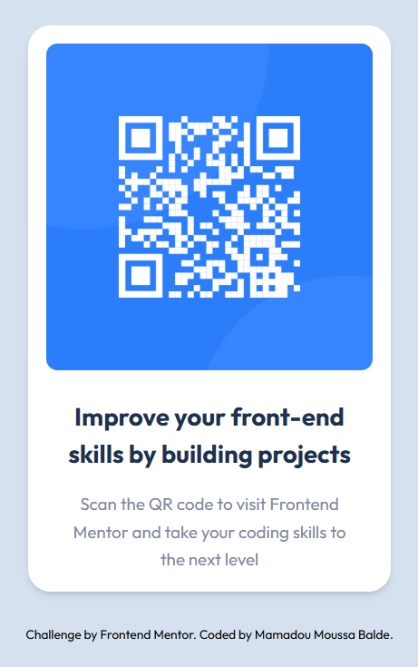

# QR code component

A single card on a pale blue page. It shows a QR code, a heading, a short instruction, and a footer credit.

## Description

Open `index.html` in a browser. Tailwind and the Outfit font load from a CDN, so the page needs a network connection for those styles.

The card contains:

* QR image from `images/image-qr-code.png`, with the alt text “QR Code”
* Heading: Improve your front-end skills by building projects
* “Scan the QR code to visit Frontend Mentor and take your coding skills to the next level”
* Footer: Challenge by [Frontend Mentor](https://www.frontendmentor.io?ref=challenge). Coded by Mamadou Moussa Balde. That name links to `#`, so it stays on this page.
* The footer links are black with no underline. Keyboard focus draws a dark outline around the focused link.

The card is 320px wide on a `#d5e1ef` page, with a white background, rounded corners, and a soft shadow.

This is a solution to the Frontend Mentor QR code component challenge.

## Screenshots

The QR image, heading, and instruction sit on a white card. The footer credit is below it.

## Getting Started

### Dependencies

* A browser
* A network connection, because Tailwind and Outfit load from a CDN

### Installing

No install step.

### Executing program

Open `index.html` in a browser.

## Help

Without a network connection, Tailwind and the Outfit font do not load. The name in the footer links to `#`, so it stays on this page.

## Authors

[Mamadou Moussa Balde](https://www.linkedin.com/in/2mb/)

## Version History

* Current page
    * One 320px card on `#d5e1ef`
    * Frontend Mentor QR code component challenge

## License

This folder does not include a `LICENSE.md` file.

## Acknowledgments

* [Frontend Mentor](https://www.frontendmentor.io?ref=challenge)
* [Outfit](https://fonts.google.com/specimen/Outfit)
* [README template](https://gist.github.com/DomPizzie/7a5ff55ffa9081f2de27c315f5018afc)
